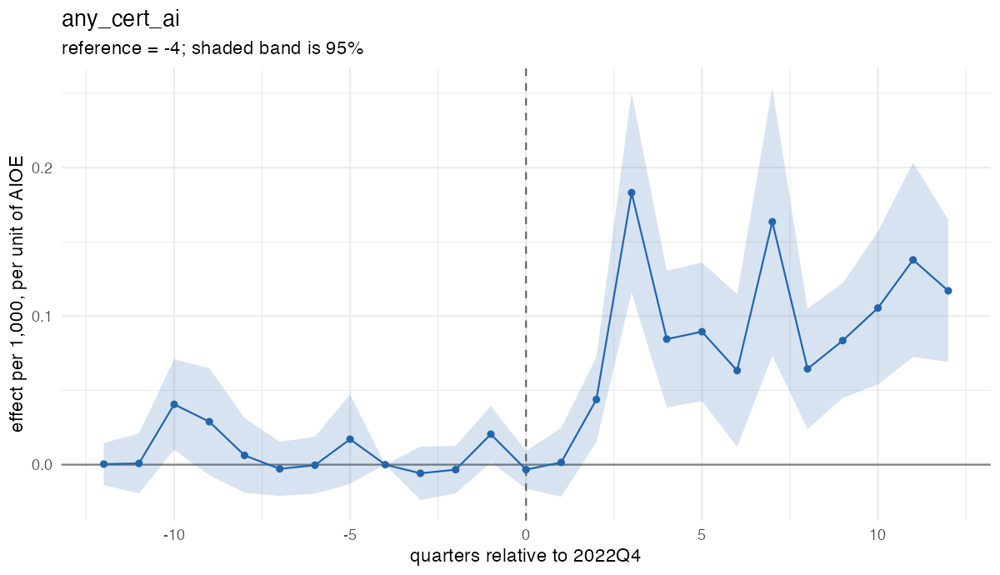
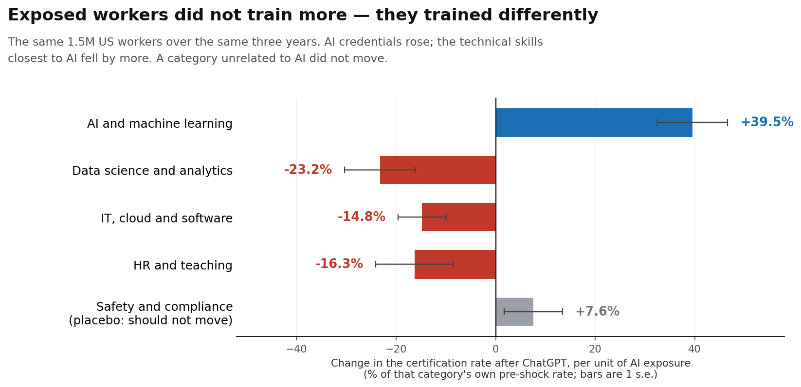
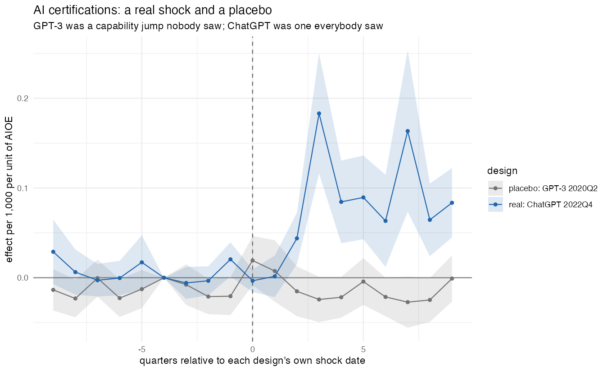

# Retraining Without More Training: AI Exposure and the Composition of Skill Investment

Job market paper, 2026-27. **Draft in progress.** Rajib Oraon, Department of Economics,
New York University. Contact: [ro2094@nyu.edu](mailto:ro2094@nyu.edu).

This repository documents the paper's question, design and main results. Code and
replication materials are not posted yet; see [Status](#status) below.

## The question

American schools are being rebuilt around artificial intelligence. That effort is aimed at
people who have not yet entered the labor market. It says nothing about the 159 million
Americans already on a payroll, most of whom will not return to a classroom.

If a technology arrives that can perform a meaningful share of your daily tasks, and no
institution is retraining you, do you retrain yourself?

## Abstract

> Does exposure to artificial intelligence lead workers to retrain? Using résumé microdata
> on 1.5 million American workers observed quarterly from 2018 to 2025, I measure
> occupational AI exposure fixed before the public release of ChatGPT and estimate its
> effect on subsequent credential acquisition. Exposed workers became 39 percent more
> likely to earn an AI certification, an effect that persists for ten quarters. They did
> not train more overall: certifications in data science fell 23 percent and in cloud
> computing 15 percent, while an unrelated category was unchanged. What changed was the
> composition of training, not its level. A placebo at the release of GPT-3 — a larger
> capability advance that few workers encountered — yields a null whose confidence interval
> excludes the main estimate, indicating that the response was to the technology's
> visibility rather than to its capability. Reallocation is concentrated among
> postgraduates, who respond two and a half times as strongly as others, and appears at the
> preparatory margin only: certification responds while promotion does not. Workers adjust
> the composition of their human capital well before adjustment becomes visible in
> employment outcomes.

**Keywords:** artificial intelligence, human capital, retraining, occupational exposure,
technological change · **JEL:** J24, O33, J62, I26

## Design

Generative AI arrived everywhere at once, so there is no region, firm or cohort that the
technology reached later and no untreated group in the usual sense. What varies is not
whether a worker was exposed but *how much*: a paralegal and a plumber both learned of
ChatGPT in December 2022, and only one of them had reason to think it could do part of
their job.

Treatment is therefore the **intensity** of exposure and the timing is the public release
of ChatGPT on 30 November 2022. Exposure is the AI Occupational Exposure index
([Felten, Raj and Seamans, 2021](https://doi.org/10.1002/smj.3286)) of the occupation a
worker held in October 2022, matched from free-text job titles through O\*NET.

Two features of the design carry most of the weight:

- **Exposure is fixed at its pre-shock value and never updated.** If exposure moved with a
  worker's current occupation, anyone escaping an exposed occupation would immediately be
  recorded as unexposed, and the very response the design exists to detect would be erased.
- **The identifying assumption is tested and reported for every outcome.** Results that
  fail the parallel-trends test are not interpreted as effects. Where a violation is a
  linear trend, estimates are reported both raw and trend-adjusted.

Person fixed effects absorb everything time-invariant about a worker, including how
completely they maintain their résumé. Tenure band, sex and baseline industry each receive
their own quarterly time path, so effects are identified off workers who share an industry,
a tenure band and a sex, and differ in the exposure of the occupation they happened to hold
in October 2022. Standard errors are clustered on baseline occupation (683 clusters).

### Sample construction

| Restriction | Workers |
|---|---|
| Raw extract, United States | 66,614,659 |
| Job title matched to an O\*NET occupation | 46,093,220 |
| Occupation has an AIOE score | 35,976,573 |
| Observable after June 2023 | 25,686,865 |
| **Stratified subsample used for estimation** | **1,499,267** |

Each row applies the stated restriction cumulatively. The final row draws a subsample
stratified on exposure decile, giving a balanced quarterly panel of **47,976,544
person-quarters** covering 2018Q1 to 2025Q4.

## Findings

### 1. Workers in exposed occupations acquired AI credentials

A one-unit increase in baseline exposure raises the quarterly probability of earning an
AI-related certificate by 39.5 percent of its pre-shock base rate. Nothing happens in the
quarter of the release itself. The effect appears two quarters later, consistent with the
time it takes to choose, enrol in and complete a short course, and then persists for ten
quarters without decaying.

This is one of the few outcomes in the paper whose parallel-trends assumption is not
rejected (*p* = 0.10), and it is the one the central claim rests on.

### 2. They did not train more, they trained differently

If the response were generalised anxiety about skills, every category of credential should
have risen. The opposite happened in the categories closest to AI. Certificates in data
science and analytics fell 23.2 percent, IT and cloud fell 14.8 percent, and HR and
teaching fell 16.3 percent, in the same workers over the same window under the same
specification. Each decline is larger in absolute terms than the increase in AI
certificates.

The category that ought not to move does not. **Safety and compliance** — forklift
operation, first aid, hazardous materials — has no plausible connection to generative AI and
serves as the paper's within-outcome placebo. Its coefficient is +0.013 against a standard
error of 0.010, indistinguishable from zero, and its pre-trend test passes. Leadership and
soft-skills certification is likewise flat.

Summing across categories, the increase and the decreases account for one another. Total
credentialing did not rise. What changed was the composition of training, not its level.

### 3. The response was to visibility, not to capability

GPT-3 was released in June 2020. In raw capability terms it was the larger jump, larger
than the subsequent step to ChatGPT, but it was distributed as a developer API, attracted
little attention outside the field, and was encountered by almost no ordinary worker.
ChatGPT was a smaller technical advance wrapped in an interface anyone could use.

Running the identical specification with the shock at 2020Q2, on a sample truncated before
the real shock can contaminate it, yields a precise null: **−0.004, CI [−0.014, +0.005]**,
against **+0.081, CI [+0.050, +0.112]** for the real shock. The intervals do not overlap.

The capability had been available for two and a half years before workers reacted to it.
They reacted when it became something they could see.

## Two further results

**Who responded.** Reallocation is concentrated among workers holding postgraduate degrees,
who respond roughly two and a half times as strongly as workers with a bachelor's degree,
and among workers at large firms. These are the workers best placed to act, not those most
exposed to harm, which is an argument for retraining policy being targeted rather than
universal.

**Where it shows up.** Certification responds; promotion does not. Adaptation appears at the
preparatory margin and not yet at the realised one, which suggests early adjustment to AI
is better measured by what workers are preparing to do than by what they have done.

## What this data cannot answer

An unusual amount of the paper is given over to results that could not be obtained, because
each produced a plausible, sizeable, statistically significant coefficient that would have
been straightforward to report as a finding, and each is an artifact:

- **Job loss cannot be studied.** The sample conditions on being employed in October 2022.
- **Escape from exposed work is regression to the mean.** Any variable defined relative to
  the baseline job inherits that quarter as a reference point and traces a symmetric pattern
  around it, of equal magnitude twelve quarters before the shock and twelve after.
- **The education enrolment trend is a recording artifact.** Résumé coverage of education
  improves toward the present, and so would any variable whose recording improves over time.
- **An apparent null for workers without a degree was a coverage effect.** Those workers
  record roughly a third as much of everything on their résumés; restricted to workers who
  demonstrably maintain their certification records, they respond as strongly as
  undergraduates.

Résumé data record not what workers did but what workers chose to write down. The
diagnostics that separate behavior from recording are not complicated, but they have to be
run.

## Data availability

The worker data are résumé microdata from **People Data Labs**, obtained through **Dewey
Data**, and are **licensed. They are not redistributed here and never will be.** The
`.gitignore` in this repository blocks the raw extracts and every derived panel by default.

Reproducing the analysis requires an independent license. The
[AI Occupational Exposure index](https://github.com/AIOE-Data/AIOE) and
[O\*NET](https://www.onetcenter.org/database.html) are both publicly available.

## Status

| Component | State |
|---|---|
| Draft | First complete draft, September 2026 |
| Question, design, main results | In this README |
| Full paper PDF | Available on request |
| Data construction code | Not yet posted |
| Estimation code and table scripts | Not yet posted |

Code will be added once the draft settles and the pipeline is cleaned for release. Posting
estimation code that reads a licensed panel nobody else can obtain would not make the
analysis reproducible, so it waits until the accompanying documentation makes it useful.

## Related work

- [Predicting Corporate Default: A Dynamic Logit Benchmark versus Machine Learning](https://github.com/rajibor24/credit-risk-default-prediction)
- [Effect of Fast Internet Access on Human Capital Formation: Evidence from India](https://github.com/rajibor24/bharatnet-human-capital)
