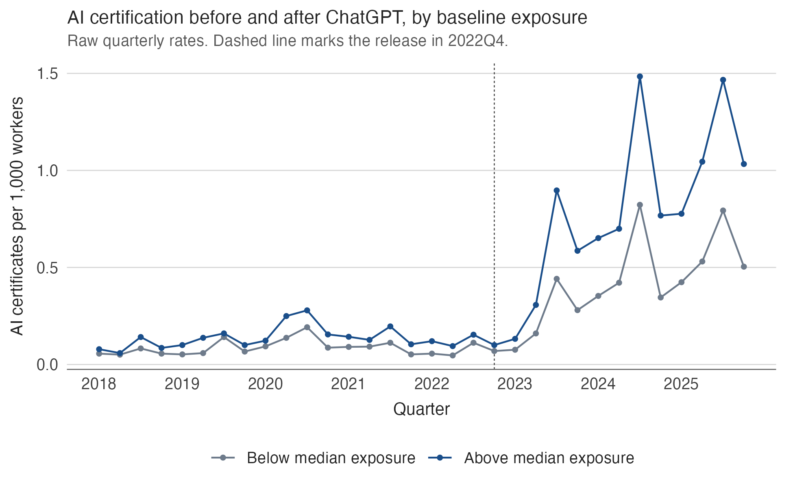
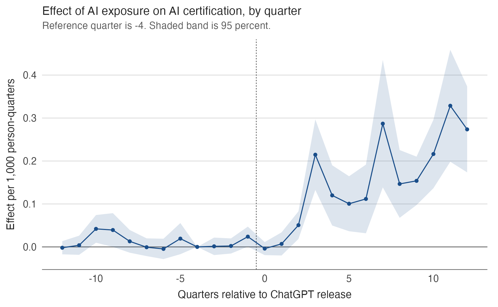
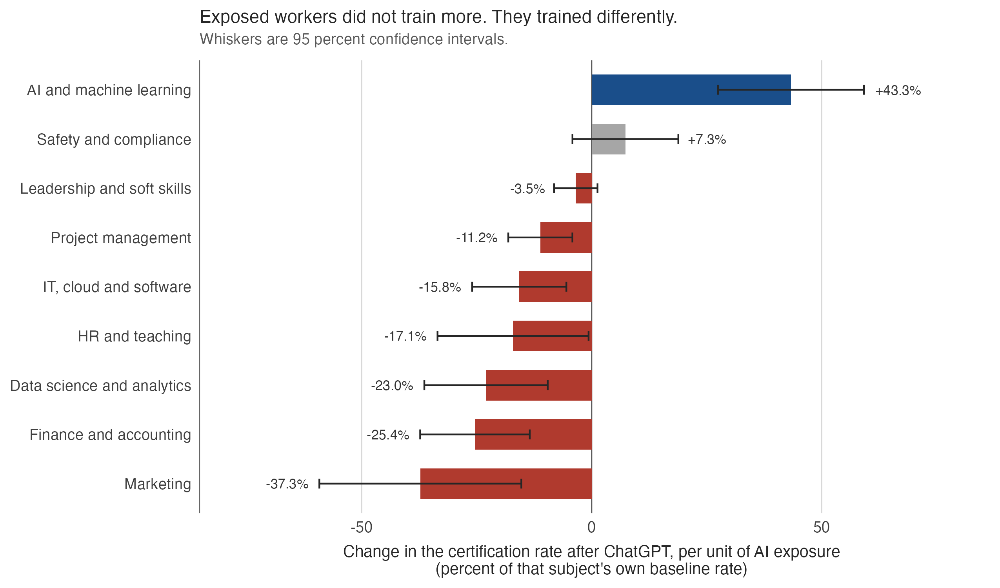
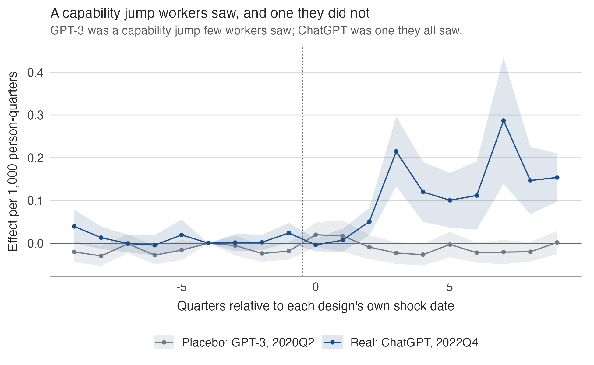
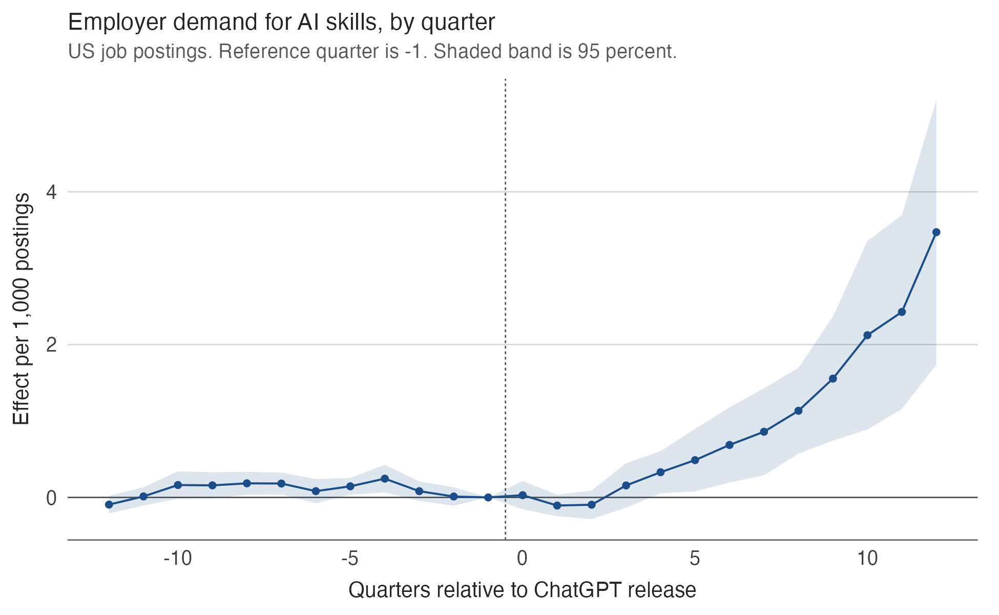
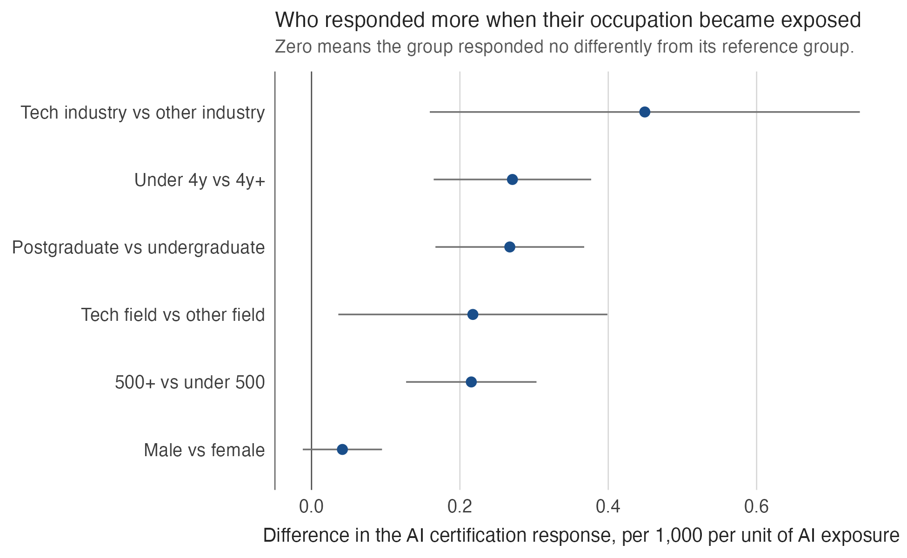

# Adapting to Artificial Intelligence: Worker Skill Investment after ChatGPT

Job market paper, 2026-27. **Draft in progress.** Rajib Oraon, Department of Economics, New York University. Contact: [ro2094@nyu.edu](mailto:ro2094@nyu.edu) · [rajiboraon.com](https://rajiboraon.com)

This repository documents the paper's question, design and main results. Code and replication materials are not posted yet; see [Status](#status) below.

## The question

American schools are being rebuilt around artificial intelligence. That effort is aimed at people who have not yet entered the labor market. It says nothing about the 159 million Americans already on a payroll, most of whom will not return to a classroom.

If a technology arrives that can perform a meaningful share of your daily tasks, and no institution is retraining you, do you retrain yourself? And if you do, do you train *more*, or do you change *what* you train in?

Raw quarterly rates, no controls. The divergence after late 2022 is what the rest of the paper tries to break.

## Abstract

> How do incumbent workers adjust their human capital when a new technology changes the value of existing skills? I study this question using quarterly résumé histories for 1.5 million U.S. workers from 2018 through 2025 and the public release of ChatGPT as a common shock. Treatment intensity is the pre-release AI exposure of a worker's occupation. Workers in more exposed occupations become substantially more likely to earn AI-related credentials after ChatGPT. This increase does not represent a broad expansion of training: the same workers reduce certification in adjacent technical fields, including data science and cloud/IT, and in other discretionary subjects such as marketing and finance, while safety and compliance credentials do not move and total certification does not increase. The response is therefore primarily a reallocation of human-capital investment across skills. Adjustment is stronger among postgraduates, workers with technical backgrounds, employees at large firms, workers with shorter tenure, and workers already employed in technology industries. Employer demand for AI skills subsequently rises more in exposed occupations, but worker certification begins to increase before this rise in vacancy demand becomes clearly detectable. The findings are consistent with workers reallocating skill investment in anticipation of technological change before changes in posted labor demand are fully visible.

**Keywords:** artificial intelligence, generative AI, human capital, skill investment, professional certification, occupational exposure, worker adaptation · **JEL:** J24, O33, J23, M53

## Design

Generative AI arrived everywhere at once, so there is no region, firm or cohort that the technology reached later and no untreated group in the usual sense. What varies is not whether a worker was exposed but *how much*: a paralegal and a plumber both learned of ChatGPT in December 2022, and only one of them had reason to think it could do part of their job.

Treatment is therefore the **intensity** of exposure and the timing is the public release of ChatGPT on 30 November 2022. Exposure is the AI Occupational Exposure index ([Felten, Raj and Seamans, 2021](https://onlinelibrary.wiley.com/doi/10.1002/smj.3286)) of the occupation a worker held in October 2022, matched from free-text job titles through O\*NET.

Two features of the design carry most of the weight:

- **Exposure is fixed at its pre-shock value and never updated.** If exposure moved with a worker's current occupation, anyone escaping an exposed occupation would immediately be recorded as unexposed, and the very response the design exists to detect would be erased.
- **The identifying assumption is tested and reported for every outcome.** Results that fail the parallel-trends test are not interpreted as effects. Where a violation is a linear trend, estimates are reported both raw and trend-adjusted.

Person fixed effects absorb everything time-invariant about a worker, including how completely they maintain their résumé. Tenure band, sex and baseline industry each receive their own quarterly time path, so effects are identified off workers who share an industry, a tenure band and a sex, and differ in the exposure of the occupation they happened to hold in October 2022. Standard errors are clustered on baseline occupation (683 clusters).

### Sample construction

| Restriction | Workers |
|---|---|
| Raw extract, United States | 66,614,659 |
| Job title matched to an O\*NET occupation | 46,093,220 |
| Occupation has an AIOE score | 35,976,573 |
| Observable after June 2023 | 25,686,865 |
| **Stratified subsample used for estimation** | **1,499,267** |

Each row applies the stated restriction cumulatively, and the sample also requires employment in October 2022 with at least six months of tenure in that job. The final row draws a subsample stratified on exposure decile, giving a balanced quarterly panel of **47,976,544 person-quarters** covering 2018Q1 to 2025Q4.

Résumé job titles are free text, so the **211,642** distinct baseline titles are mapped to O\*NET-SOC occupations in four tiers: exact occupation-name matches, official O\*NET alternate titles, fuzzy string matches above a pre-specified similarity threshold, and language-model-assisted classification of residual cases using title and industry context. The crosswalk is fixed before any outcome is estimated.

## Findings

### 1. Workers in exposed occupations acquired AI credentials

A one-unit increase in baseline exposure raises the quarterly probability of earning an AI-related certificate by **0.157 per 1,000 person-quarters** (s.e. 0.029), or **43.3 percent** of the estimation-window mean. Nothing happens in the quarter of the release itself. The effect appears two quarters later, consistent with the time it takes to choose, enrol in and complete a short course, and then persists through 2025Q4 without decaying.

The intensive margin agrees: the count of AI credentials rises 0.229 per 1,000 against a mean of 0.502, or **45.6 percent**. The close correspondence between the two says the increase comes from more workers certifying, not from a few workers accumulating many credentials.

This is one of the few outcomes in the paper whose parallel-trends assumption is not rejected (*p* = 0.10), and it is the one the central claim rests on.

### 2. They did not train more, they trained differently

If the response were generalised anxiety about skills, every category of credential should have risen. The opposite happened in the categories closest to AI. Certificates in data science and analytics fell **23.0 percent**, IT, cloud and software **15.8 percent**, and human resources and teaching **17.1 percent**, in the same workers over the same window under the same specification.

The reallocation is broader than substitution away from the nearest technical neighbours. Marketing falls **37.3 percent** of its baseline rate and finance and accounting **25.4 percent**, both larger in proportional terms than data science. Project management falls 11.2 percent.

The category that ought not to move does not. **Safety and compliance** — first aid, workplace safety, hazardous materials, food handling — has no plausible connection to generative AI and serves as the paper's within-outcome placebo. Its coefficient is +0.012 against a standard error of 0.010, indistinguishable from zero, and its pre-trend test passes. Leadership and soft-skills certification is likewise flat at −3.5 percent.

Total certification does not rise. The raw count estimate is negative (−0.754 per 1,000), but that outcome carries a differential pre-trend, and allowing for it gives −0.388 with *p* = 0.19. The defensible claim is the absence of an increase, not a causal decline. What changed was the composition of training, not its level.

A complementary decomposition by issuer type points the same way: credentials from online platforms and technology vendors decline among more AI-exposed workers, which is hard to square with a general rise in digital credentialing. Issuer classification is noisy and some issuer categories show differential pre-trends, so this is treated as suggestive.

### 3. The response was to visibility, not to capability

GPT-3 was released in June 2020. In raw capability terms it was the larger jump, larger than the subsequent step to ChatGPT, but it was distributed as a developer API, attracted little attention outside the field, and was encountered by almost no ordinary worker. ChatGPT was a smaller technical advance wrapped in an interface anyone could use.

Running the identical specification with the shock at 2020Q2, on a sample truncated at 2022Q3 so the real shock cannot contaminate it, yields a precise null: **+0.001, CI [−0.011, +0.012]**, against **+0.123, CI [+0.072, +0.175]** for the real shock on a symmetric window. The intervals do not overlap.

The capability had been available for two and a half years before workers reacted to it. They reacted when it became something they could see. This rules out a smooth long-run rise in AI credentialing that any candidate date would have picked up. It does not, by itself, separate public salience from ease of access, employer adoption, or new information about what the technology could do.

### 4. Employer demand rises, but later

If the certification response were simply workers reading new requirements off job ads, demand should move first. It does not.

Using LinkUp vacancy data, postings are collapsed to unique vacancies, classified as AI-related by LinkUp's AI Skills tag, mapped to six-digit O\*NET occupations and aggregated to the occupation-quarter, dropping cells with fewer than 30 vacancies. The outcome is the AI-related *share* of vacancies, which separates the skill content of hiring from the volume of hiring.

With occupation and quarter fixed effects, a one-unit increase in AIOE is associated with **1.304 additional AI-related vacancies per 1,000 postings** (s.e. 0.257), or **49.0 percent** of the sample mean of 2.66. So employer demand does move in the same direction.

The timing is the point. Worker certification begins rising around **2023Q2**. The differential increase in AI-related vacancies becomes clearly detectable around **2023Q4**. Workers moved first.

Splitting occupations by AI vacancy demand measured entirely *before* ChatGPT points the same way: the certification response is 0.119 per 1,000 where there was no prior AI demand, 0.161 where it was low, and **0.373 where it was high**. The response is largest, in levels, where employers had already revealed demand for AI skills.

### 5. Not obviously defensive, not obviously complementary

Using the Anthropic Economic Index, which classifies realised AI use across O\*NET tasks, occupations are split at the median of observed automation intensity and separately of augmentation intensity. AI certification rises in both halves and the differences are small and insignificant: 0.064 (*p* = 0.538) for automation, −0.047 (*p* = 0.585) for augmentation.

These measures capture post-release usage, so the comparison is descriptive rather than causal. It provides no evidence for a sharp mechanism in which defensive reskilling is confined to automation-intensive work, or complementary investment to augmentation-intensive work.

## Two further results

**Who responded.** Subgroup differences are estimated as triple interactions and tested directly, rather than compared by eye across separately estimated coefficients. Workers whose baseline job was in a technology industry respond 0.449 per 1,000 more than others (*p* = 0.002); workers with under four years of tenure 0.271 more (*p* = 7.3 × 10⁻⁷); postgraduates 0.267 more than workers with a bachelor's degree (*p* = 2.3 × 10⁻⁷); workers with a prior technical field of study 0.217 more (*p* = 0.019); workers at firms of 500 or more 0.215 more (*p* = 1.9 × 10⁻⁶). Men have a larger point estimate than women but the difference does not survive the direct test (*p* = 0.13). These are the workers best placed to act, not those most exposed to harm, which is an argument for retraining policy being targeted rather than universal.

**Robustness.** Replacing continuous exposure with discrete contrasts gives the same qualitative pattern and grows as the contrast widens: 0.163 above-median, 0.229 top-versus-bottom quartile, 0.359 top-versus-bottom decile. Allowing an exposure-specific linear trend leaves AI certification positive and significant, data science and IT/cloud negative, and the safety placebo near zero. Excluding records flagged for imprecise dates, implausible tenure or non-U.S. primary employment removes 4.8 percent of person-quarters and moves the preferred estimate from 0.157 to 0.160.

## What this data cannot answer

An unusual amount of the paper is given over to results that could not be obtained, because each produced a plausible, sizeable, statistically significant coefficient that would have been straightforward to report as a finding, and each is an artifact:

- **Job loss cannot be studied.** The sample conditions on being employed in October 2022.
- **Escape from exposed work is regression to the mean.** Any variable defined relative to the baseline job inherits that quarter as a reference point and traces a symmetric pattern around it, of equal magnitude twelve quarters before the shock and twelve after.
- **The education enrolment trend is a recording artifact.** Résumé coverage of education improves toward the present, and so would any variable whose recording improves over time.
- **An apparent null for workers without a degree was a coverage effect.** Those workers record roughly a third as much of everything on their résumés; restricted to workers who demonstrably maintain their certification records, they respond as strongly as undergraduates.

The October 2022 tenure requirement is also useful for fixing a stable pre-shock occupation but mechanically constrains mobility outcomes near the baseline date, which is one reason certification rather than job change forms the core of the paper. And the data carry no wages, so the return to these credentials is not measured.

Résumé data record not what workers did but what workers chose to write down. The diagnostics that separate behavior from recording are not complicated, but they have to be run.

## Data availability

The worker data are résumé microdata from **People Data Labs**, obtained through **Dewey Data** under New York University's institutional subscription, and are **licensed. They are not redistributed here and never will be.** The `.gitignore` in this repository blocks the raw extracts and every derived panel by default. The vacancy data from **LinkUp** come through the same subscription under the same restriction.

Reproducing the analysis requires an independent license. The [AI Occupational Exposure index](https://onlinelibrary.wiley.com/doi/10.1002/smj.3286), [O\*NET](https://www.onetonline.org/) and the [Anthropic Economic Index](https://www.anthropic.com/economic-index) are all publicly available.

## Status

| Component | State |
|---|---|
| Draft | Current draft, October 2026 |
| Question, design, main results | In this README |
| Full paper PDF | Available on request |
| Data construction code | Not yet posted |
| Estimation code and table scripts | Not yet posted |

Code will be added once the draft settles and the pipeline is cleaned for release. Posting estimation code that reads a licensed panel nobody else can obtain would not make the analysis reproducible, so it waits until the accompanying documentation makes it useful.

## Related work

- [Predicting Corporate Default: A Dynamic Logit Benchmark versus Machine Learning](https://github.com/rajibor24/credit-risk-default-prediction)
- [Effect of Fast Internet Access on Human Capital Formation: Evidence from India](https://github.com/rajibor24/bharatnet-human-capital)
